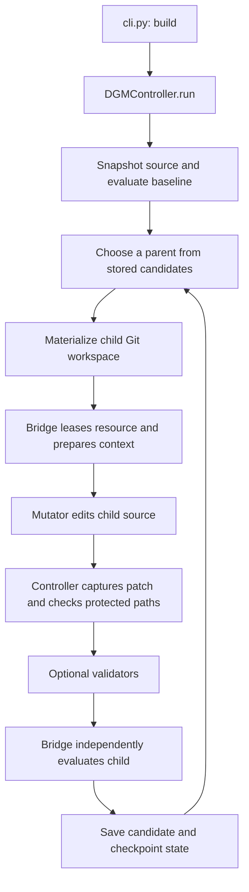
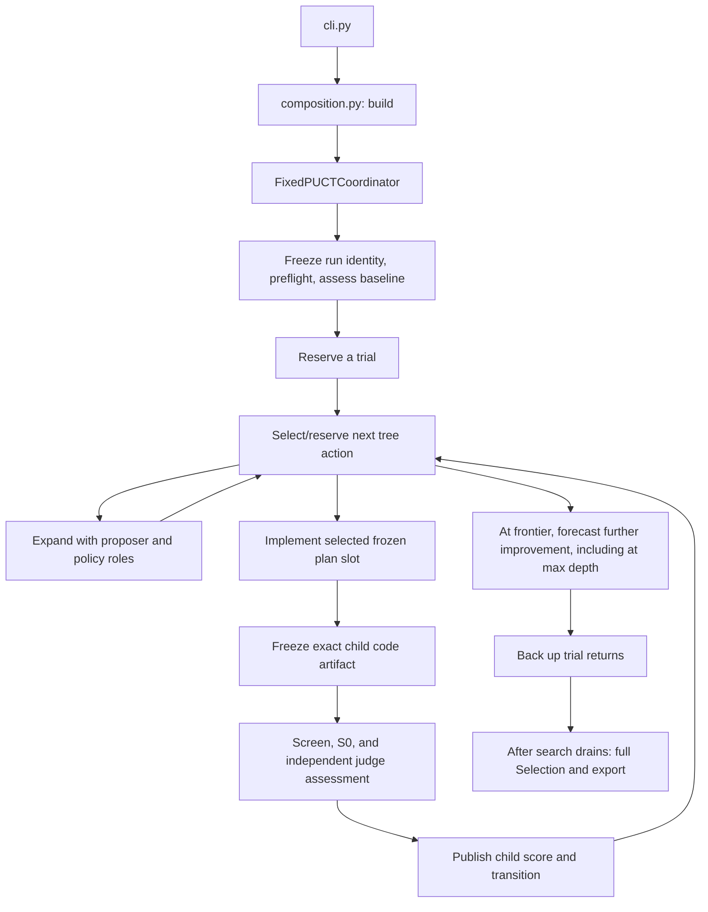

# AlphaAgents codebase guide

This guide explains the local working tree rechecked on **October 12, 2026**. It includes the uncommitted fixed-PUCT implementation, the DGM/shared package split, and the explicit MCTS integration interfaces present in this checkout. It describes code structure and behavior; it does not certify that every live integration or acceptance requirement has passed.

## 1. What this project does

AlphaAgents searches for better versions of an agent's source code. It starts from an existing agent, asks a coding backend to change a disposable copy, runs an independent evaluator, and uses the resulting evidence to decide what to try next.

There are three different responsibilities to keep in mind:

- **Search:** choose which version of the code to improve and which intervention to attempt.
- **Harness:** the agent implementation that observes a device, calls models, and takes actions.
- **Benchmark:** generate tasks, initialize the environment, and independently determine whether the agent succeeded.

For the Android experiments, Artemis or Mobile-Agent is the harness, and AndroidWorld is the benchmark. Codex is the coding agent that proposes or implements improvements. The model used by Codex and the model used by the GUI agent have separate configuration.

## 2. Repository map

```text
AlphaAgents/
├── README.md                       Short starting index
├── CODEBASE_GUIDE.md                This guide
├── pyproject.toml                  Python packaging, CLI, test configuration
├── alpha_agents.md                 Detailed project/experiment specification
├── IMPLEMENTATION_PLAN.md           Implementation and acceptance planning
├── IMPLEMENTATION_AUDIT.md          Recorded verification and development evidence
├── androidworld_sets_manifest.json  Benchmark task partition and metadata
├── alpha_agents/
│   └── tree_search/                 Search framework owned by this project
│       ├── __main__.py              python -m entry point
│       ├── cli.py                   CLI parsing and DGM composition
│       ├── composition.py           Fixed-PUCT production composition
│       ├── core/                    Search contracts, state, and workspaces
│       │   ├── dgm/                 DGM archive search and candidate lifecycle
│       │   ├── mcts/                Fixed-PUCT search implementation
│       │   └── shared/              Atomic JSON, run locking, and Git commands
│       ├── bridges/                 Trusted harness/evaluation adapters
│       │   └── androidworld/        Device execution and AndroidWorld integration
│       ├── mutators/                Code-editing backends
│       │   └── coding_agents/codex/ Codex execution, role adapters, and prompts
│       ├── validators/              Optional DGM engineering checks
│       ├── infrastructure/          Shared process and command utilities
│       ├── examples/                Configurations and an offline toy harness
│       └── tests/                   Main framework regression tests
├── harness/
│   ├── mobile-gui/                  Mobile-Agent v3.5 source
│   └── artemis/                     Migrated Artemis source, config, and apps
├── eval/
│   ├── android_world/               AndroidWorld Git submodule
│   ├── MobileWorld/                 MobileWorld Git submodule
│   ├── run_artemis_androidworld.py  Direct Artemis benchmark runner
│   ├── run_mobile_agent_v35.py      Direct Mobile-Agent benchmark runner
│   ├── run_android_world_parallel.py Parallel emulator/evaluation launcher
│   ├── mobile_agent_env.py          Mobile-Agent environment compatibility
│   ├── setup.sh                     Local dependency/environment setup
│   └── tests/                       Evaluation wrapper tests
├── runs/                           Local experiment outputs and reports
│   ├── experiments/                Search experiment directories
│   └── verification/               Verification artifacts
├── plan-walkthrough/                Local walkthrough/hosting artifacts
├── build/                          Generated package build output
└── alpha_agents.egg-info/           Generated installed-package metadata
```

`runs/`, build outputs, caches, and virtual environments are ignored local artifacts. Their presence depends on the machine. `plan-walkthrough/` currently contains distribution/hosting artifacts rather than a Python search entry point.

The two benchmark checkouts are Git submodules declared in [.gitmodules](.gitmodules). Artemis is a copied source tree, not one of those submodules. The root Python package includes `alpha_agents*`; installing it does not automatically install every harness and benchmark dependency.

## 3. Two search paths

The shared CLI selects the controller using `controller.type`. If that field is absent, it defaults to `dgm`.

| Question | DGM path | Fixed-PUCT path |
| --- | --- | --- |
| Main orchestration | `core/dgm/controller.py`: `DGMController` | `core/mcts/coordinator.py`: `FixedPUCTCoordinator` |
| Search execution | Parent selection and child lifecycle in one controller | `core/mcts/controller.py`: `TrialExecutor` |
| Config construction | `cli.py` | `composition.py`, reached through `cli.py` |
| Search structure | Archive of candidate versions with parent lineage | Tree of harness versions, frozen plans, and implementation slots |
| Code editing | `MutationBackend`, command or Codex | `RoleGateway`; production uses Codex proposer, policy, implementer, judge, and value roles |
| Evaluation interface | `HarnessBridge` | `StagedEvaluator` and `StageEvidence` |
| Authoritative state | `state.json` | `tree.sqlite3` |
| Current built-in evaluation | Command bridge or AndroidWorld bridge | Staged AndroidWorld evaluation of Artemis |
| Example | [command.json](alpha_agents/tree_search/examples/command.json) | [fixed_puct.json](alpha_agents/tree_search/examples/fixed_puct.json) |

DGM means Darwin Gödel Machine. MCTS means Monte Carlo tree search. PUCT is the selection rule used here to balance measured returns with policy priors and exploration. These are separate implementations in this repository; tracing the DGM controller alone will not explain the fixed-PUCT run.

The old `core/contracts.py`, `core/controller.py`, `core/storage.py`, and `core/workspace.py` paths have been removed in this working tree. DGM-specific imports now use `core/dgm/`; common JSON, locking, and Git helpers use `core/shared/`. The public DGM exports in `alpha_agents.tree_search` remain available. The production fixed-PUCT CLI still assembles Codex and AndroidWorld/Artemis, while the Python coordinator accepts replacement integrations through its ports.

## 4. DGM: follow one candidate through the code



Read [core/dgm/contracts.py](alpha_agents/tree_search/core/dgm/contracts.py) first. Its types define the boundaries:

| Type | Meaning |
| --- | --- |
| `Candidate` | A code version's ID, parent, directory, base commit, workspace, and patch paths |
| `MutationContext` | Objective, instructions, evidence, and protected paths supplied to the editor |
| `MutationOutcome` | Whether the editing backend completed; it is not a benchmark result |
| `Evaluation` | Independent completed score or evaluation failure |
| `HarnessBridge` | Supplies source, resource lease, preparation, evaluation, and resume identity |
| `MutationBackend` | Edits the candidate workspace |
| `CandidateValidator` | Adds engineering evidence such as test results |

The central method is `DGMController._child()` in [core/dgm/controller.py](alpha_agents/tree_search/core/dgm/controller.py). It prepares the workspace, writes `mutation_context.json`, invokes the mutator, captures `model_patch.diff`, validates allowed changes, evaluates the patch, and saves the record.

[core/dgm/workspace.py](alpha_agents/tree_search/core/dgm/workspace.py) handles Git workspace materialization, patch capture/recovery, and source fingerprints. [core/dgm/storage.py](alpha_agents/tree_search/core/dgm/storage.py) handles DGM checkpoints and candidate records. Both algorithms use [core/shared/storage.py](alpha_agents/tree_search/core/shared/storage.py) for atomic JSON and the exclusive run lock, and `core/shared/workspace.py` for Git commands. MCTS does not depend on DGM candidate storage or reconstruction.

Completed scores must be finite values in `[0, 1]`, with higher meaning better. Evaluation failure has no score. A permitted partial patch can still receive independent evaluation after an editing failure. Validator failures add diagnostic evidence; they do not replace the benchmark score.

The controller maintains archive, retained, and diagnostic pools. Its configuration controls parent selection, archive admission, child budget, and synchronous or asynchronous scheduling. To understand why a particular parent was chosen, read `_parent()` and `_admit()`.

## 5. Fixed-PUCT: follow one trial through the code



### The main modules

| Module under `core/mcts/` | Responsibility |
| --- | --- |
| `ports.py`, `role_contracts.py` | Explicit agent/evaluator interfaces, request serialization, role settings, and stage evidence |
| `contracts.py` | Config limits, stable fingerprints, objective, scores, rewards, judge aggregation |
| `coordinator.py` | Run identity, preflight, baseline, trial workers, stop/drain, recovery, finalization |
| `controller.py` | `TrialExecutor`: proposal, prior refresh, implementation, staged assessment, value, backup |
| `storage.py` | `TreeStore`: authoritative SQLite state, transactions, reservations, ownership, budgets, statistics |
| `policy.py` | Pure prior normalization and PUCT selection math |
| `artifacts.py` | Freeze, verify, materialize, and reconstruct exact source artifacts |
| `responses.py` | Provider-independent role response validation |
| `planning_scope.py`, `plan_archive.py` | Plan admission/scope and immutable plan/evidence exports |
| `value_context.py` | Build the continuation evidence supplied to the value role |
| `task_cache.py` | Task identities, cached outcomes, execution/dispatch records, interrupted task recovery |
| `targeted_checks.py` | Implementer-requested device diagnostics and handoff validation |
| `recovery.py` | Reconcile recorded processes after interruption |
| `finalization.py` | Freeze shortlist, evaluate full Selection, choose and export winner |
| `reporting.py`, `assessment_timing.py` | Scores, cost/timing evidence, utilization, and runtime forecasts |

### Nodes, plans, attempts, and trials

- A **node** identifies a harness version in the search tree.
- An **artifact** identifies the exact frozen source contents. Multiple records can refer to the same contents.
- A **plan** is a frozen intervention proposal attached to a parent node.
- An **attempt** fills an implementation slot for a plan and may produce a child artifact.
- A **trial** traverses tree actions, possibly making several new attempts before stopping and backing up its result.

A successful expansion publishes exactly three distinct admissible plans. Each plan has three implementation slots. Slots are selected during search; expansion does not immediately launch nine edits. Limits or interruptions can leave slots unattempted.

`policy.py` selects an edge using:

```text
Q + c × prior × sqrt(parent visits) / (1 + edge visits)
```

`Q` is the edge's average backed-up return. The second term encourages exploration according to its prior. At zero parent visits, selection prefers the highest prior, with stable ID tie-breaking. `storage.py` applies this policy to the two levels of plan and implementation choice and reserves work transactionally.

### What is being scored?

During search, the combined score is:

```text
F = (1 - judge_weight) × U + judge_weight × J
```

`U` is weighted measured success on the frozen S0 task subset. `J` is an independent harness judge aggregate covering robustness, decisions, and generalizability. The example configuration uses `judge_weight = 0.1`. A parent-to-child reward measures the change in this combined score. The value role predicts further attainable improvement from the current frontier; it does not manufacture a measured task result.

`CombinedScore.reward_to()` keeps measured and judge changes separate. `reverse_returns()` applies `G_t = r_t + discount_factor * G_(t+1)` backward from the predicted frontier value. Measured evaluation, judge, and predicted contributions are discounted separately; both PUCT levels receive the same corresponding return exactly once. `Reward.evaluation` is the generic accessor for the measured component; frozen reward/backup records retain the historical `androidworld` name. The value prediction is bounded by `-F` and `1-F`.

The search depth limit is a computation cutoff, not the endpoint of the value target. At any frontier with a nonempty trial path and no proven structural exhaustion, including a node already at `max_depth`, call the value estimator. It predicts expected discounted continuing improvement under the supplied policy:

```text
V_pi(H,E) = E_pi[sum(t >= 0) gamma^t * (F(H_(t+1)) - F(H_t))]
gamma = discount_factor, default 0.9, with 0 < gamma < 1
```

There is no finite value horizon or remaining-budget input. The hypothetical procedure continues beyond actual depth and global run-budget cutoffs, preserving used local branching capacity and allowing eligible stored children to be traversed. Future nodes gain their own local capacity; completed evidence updates priors and discounted statistics. Pending work and assessment outages are uncertainty/recovery conditions, not termination. Genuine exhaustion holds utility constant thereafter. No actual child is generated beyond `max_depth`. Empty paths and proven exhaustion back up with zero future return without an estimator invocation.

The forecast is expected improvement under this policy, not unrestricted optimal harness quality. Discounting favors earlier improvements; `0.9` is an experimental starting point with a geometric span of roughly ten transitions, not a hard endpoint. The existing bounds hold because `V = -F(H) + (1-gamma) * E[sum(k >= 1) gamma^(k-1) * F(H_k)]`. Rewards and predictions both use the frozen utility/judge mixture above; measured scores are unchanged.

Frozen capacity records distinguish `terminal` (actual search must stop) from `exhausted` (no permitted outgoing transition remains). Value requests, responses, and persisted assessments bind `discount_factor` and `continuation_policy_id` alongside artifact, objective, score, evidence, and capacity identities. The contracts are `fixed-puct-discounted-continuing-v4` and `discounted-component-backup-v2`; the policy definition is included in the snapshot. Failed value assessment still leaves the trial pending after two attempts; reaching max depth does not authorize a zero substitute.

`assess()` applies the same assessment protocol to baseline and children. Code judging can run alongside Screen/S0 execution; the execution judge then receives canonical S0 evidence and the code findings. An unavailable final judge preserves task evidence and leaves assessment pending. `_implement()` can assess a permitted nonempty patch even after an engineering failure; empty or out-of-scope patches fail the attempt.

### Consequences for allocation and forecast review

Proposer and policy requests receive the same `discount_factor`, `continuation_policy_id`, and policy definition as the value target. Their prompts compare expected discounted improvement, including delayed gains, intermediate regressions, and diminishing returns. Judges still receive artifact-only scoring evidence: discounting changes allocation, not the frozen measurement rubric.

A discount step is one harness transition, including stored traversal. Plan bookkeeping, failed implementations, tokens, and wall-clock time add no discount steps. A cost-efficiency objective would need an explicit additional cost model. Under the current objective, temporary gains can have positive return: `0.60 -> 0.70 -> 0.60` produces `0.10 - 0.9*0.10 = 0.01`. This reflects the preference for higher utility sooner, not a new best artifact.

PUCT still uses mean discounted returns plus its exploration term. The current `c_puct` and `c_impl` defaults remain unchanged; their balance against Q should be calibrated empirically under matched search budgets. Compare settings using best retained measured scores and final Selection utility, as well as forecast diagnostics. No automatic coefficient tuning or live experiment is triggered by these diagnostics.

`value_calibration` in status and final reports compares a frozen prediction with later completed trial suffixes starting at its exact frontier, under matching discount and policy identities. An `observed_path_rowid` cutoff excludes traversals recorded before the prediction snapshot. For K observed transitions, it reports the discounted measured prefix and the unknown tail bounds `gamma^K * [-F(H_K), 1-F(H_K)]`. Genuine exhaustion makes the tail zero; a depth/budget cutoff does not. Point differences are reported only for genuinely terminated continuations. A later model prediction is never substituted for a realized tail.

These are descriptive comparisons: adaptive branch selection and reused task evidence make observations correlated, and one realized outcome need not equal an expected value. `outside_possible_tail` means the forecast lies outside the interval for that observed prefix, not that its expectation is mathematically disproved. Historical snapshots without a traversal cutoff are marked unavailable. Reopening exhausted nodes or allowing new plans after local capacity is used would change the continuation policy and require a new contract version.

Finalization uses full-Selection task utility to choose the winner. It includes the baseline and up to the configured shortlist limit of distinct child artifacts ranked by S0 utility. A final Selection winner is not automatically a held-out Confirmation result.

Shortlist ties prefer an unused parent/plan lineage, then artifact ID. Final winner ties prefer the baseline, then shallower depth, then artifact ID. Any failed shortlist evaluation leaves final Selection incomplete with no winner. Finalization freezes its shortlist only after trials have completed and invocation reservations have settled.

### Limits: trials, attempts, invocations, and time

These limits count different units. The current defaults and v1 constraints are defined in `FixedPUCTConfig`:

| Setting | Meaning |
| --- | --- |
| `max_depth = 8` | Maximum modification depth; plan nodes do not add depth |
| `discount_factor = 0.9` | Discount continuing score changes; frozen per run and strictly between zero and one |
| `max_trials = 30` | Maximum admitted trials for the run |
| `max_new_attempts_per_trial = 3` | Maximum new implementation attempts within one trial |
| `max_attempts = 90` | Maximum implementation attempts across the run |
| `max_plans = 3`, `max_implementations = 3` | Exactly three plans per successful expansion and three slots per plan |
| `trial_workers = 2`, `device_limit = 6` | Maximum concurrent trial workers and configured device pool size |
| `role_invocation_cap = 2000` | Shared run-wide budget for role execution sessions |
| `role_timeout_seconds = 7200` | Two-hour deadline for each individual role invocation |
| `shortlist_limit = 3` | Maximum distinct child artifacts included alongside the baseline in final Selection |

The depth, trial, attempt, worker, device, and shortlist defaults are also v1 ceilings; lower positive values are accepted. Plan/slot counts and the 7,200-second deadline are fixed. The discount factor controls the geometric weighting of continuation without a finite prediction horizon. The invocation cap accepts positive integers and can be increased through an audited operator grant.

An invocation is a role session, potentially containing many model requests and tool calls. Proposer, policy, implementer, judge, and value calls share the budget. `TreeStore.budget()` reports `spent`, `reserved`, and `available`; reservations protect calls needed to complete admitted work. A consumed call counts even if execution fails, while reuse of a validated stored response does not launch another call. The per-invocation deadline does not bound the whole search's wall-clock duration.

Use `FixedPUCTConfig.from_mapping()` for the generic setting names above. The dataclass constructor and frozen records retain `codex_invocation_cap` and `codex_run_timeout_seconds`; generic properties expose the same values.

## 6. AndroidWorld bridge and evaluation stages

[bridges/androidworld/](alpha_agents/tree_search/bridges/androidworld/README.md) owns task semantics and device execution. The search core does not import the concrete AndroidWorld or Codex adapters; `composition.py` connects those implementations to the core interfaces.

The interfaces live in `core/mcts/ports.py`. Core calls explicit adapter methods for preflight, owner sessions, preparation, evidence verification, and recovery. It does not inspect the agent runtime or evaluator cache. Both adapters must declare diagnostic support before an implementation receives a check channel.

| Interface | Operations to follow |
| --- | --- |
| `RoleGateway` | `preflight()`, `enrich_context()`, `prepare_request()`, `invoke()`, `invoke_with_checks()`, and `observed_usage()` |
| `RoleRequest` in `role_contracts.py` | Request identities, context, timeout, prompt hashes/modes, `render()`, and `to_record()` |
| `StagedEvaluator` | `preflight()`, `for_owner()`, `prepare()`, `evaluate()`, `verify_stage()`, and `reconcile_interrupted()` |
| `StageEvidence` | Exact artifact/stage, normalized Boolean outcomes, trusted evidence references, and exact requested-task validation |

`RoleAdapter` supplies defaults for local integrations; subclasses implement `prepare_request()` and `invoke()`. `EvaluationAdapter` subclasses implement `evaluate()`. Its verification and reconciliation defaults do nothing and are appropriate only for uncached integrations without external background work. Persistent evaluators must implement those hooks. Evaluators must support concurrent calls or return owner-specific sessions from `for_owner()`.

The fixed protocol remains Screen/S0/Selection with binary task outcomes and the combined-score objective. `StageEvidence` also permits targeted diagnostics; it does not accept Confirmation as a development evaluation stage. Replacing integrations does not automatically introduce arbitrary stages, objectives, or new CLI backend names.

`composition.build()` returns a `SearchApplication` that owns the coordinator and device scheduler. Its context manager or `close()` drains the scheduler before closing search state. The coordinator itself has no scheduler attribute. This ownership makes integration replacement and failure cleanup predictable.

Construction proceeds through config normalization, subset preparation, benchmark source attestation, evaluator/model and prompt identities, then scheduler, task cache, artifact store, evaluator, and coordinator creation. The scheduler starts after successful assembly. Construction failures close acquired scheduler/coordinator resources. Evaluator owner sessions borrow the shared resources; application shutdown owns their lifecycle.

| Module | Where to look when tracking execution |
| --- | --- |
| `bridge.py` | DGM `AndroidWorldBridge` integration |
| `evaluation.py`, `runtime.py`, `devices.py` | Evaluation orchestration and runtime/device management used by the bridge |
| `artemis.py`, `artemis_runner.py` | Trusted Artemis evaluation launch and task execution |
| `staged_evaluator.py` | Fixed-PUCT `StagedArtemisEvaluator`, cache use, staged task execution, evidence verification |
| `scheduler.py` | Shared device task queue and assignment |
| `prepare_subset.py` | Deterministic metadata-based selection and weighting of S0 |
| `task_sets.py`, `tasks.json` | Task partition utilities and task metadata |
| `runtime_attestation.py` | Verify the configured benchmark checkout/source identity |
| `device_preflight.py`, `fixture_preflight.py`, `model_health.py` | Runtime readiness checks |
| `runtime_limits.py`, `phase_watch.py`, `task_outcomes.py` | Phase deadlines and trusted distinction between agent outcomes and infrastructure failure |
| `answer_handoff.py`, `memory_compat.py` | Harness/runner compatibility handling |
| `benchmark.py` | Full-benchmark audit support |

The current manifest separates 5 Screen, 20 Selection, and 91 Confirmation task templates. S0 is a weighted 10-template subset of Selection, selected using family/difficulty quotas and app/tag coverage, rather than observed success.

| Stage | Purpose |
| --- | --- |
| Screen | Early evaluation gate; config chooses execution-valid or all-success admission |
| S0 | Canonical weighted search measurement on the fixed Selection subset |
| Selection | Full development-set measurement for promotion/final winner selection |
| Confirmation | Protected held-out tasks excluded from development evidence |
| Targeted checks | Scoped diagnostics requested during implementation; separate from canonical reward samples |

A real agent failure and an infrastructure failure have different meanings. Task cache and recovery code preserve this distinction. Cache keys bind results to exact artifact, task/seed, model, evaluator, fixture, and execution settings. A result from another code version or runtime is not interchangeable merely because the task name matches.

## 7. Codex backends and prompt ownership

The Codex integration lives in [mutators/coding_agents/codex/](alpha_agents/tree_search/mutators/coding_agents/codex/).

The DGM path uses `backend.py` (`CodexMutator`) and `worker.py`. The fixed-PUCT path uses `roles/codex.py` (`CodexGateway`) and the process worker in `roles/adapter.py`. Both paths share execution/serialization helpers, but have different execution contracts.

| Fixed-PUCT role | Job |
| --- | --- |
| Proposer | Use native Plan execution to propose admissible, diverse interventions |
| Policy | Assess relative plan priorities and refresh them when new evidence warrants it |
| Implementer | Use native Goal execution to implement one frozen intervention in its assigned workspace |
| Code judge | Inspect the exact harness artifact independently |
| Execution judge | Combine canonical task evidence with code findings into the final harness assessment |
| Value | Estimate remaining attainable improvement under the frozen frontier capacity |

`roles/prompts.py` builds requests from inspectable assets. [roles/prompts/README.md](alpha_agents/tree_search/mutators/coding_agents/codex/roles/prompts/README.md) explains the Markdown role templates, shared instructions, Goal objective, repair instructions, and `context_guidance.json`.

Every role template now includes a versioned rubric. Proposer gates cover diagnosis, executable mechanism, scope, novelty, verification and allocation relevance. Policy compares causal support, discounted timing, feasible continuation, downside and information value. Implementer gates cover fidelity, correctness, artifact integrity, actual checks and an auditable handoff. Code review develops source-backed findings and execution questions; execution review resolves those hypotheses against canonical evidence. Value follows baseline binding, mechanism support, continuation scenarios, timing, uncertainty and contract validation without inventing another ordinal score.

The production objective uses `artifact-quality-rubric-v2`. `judge_common.md` defines fifteen behavioral anchors: five ratings for each of robustness, decisions and generalizable. Supported mixed quality is distinct from missing evidence. Confidence describes support and does not rescale ratings; unknown dimensions retain explicit nulls and the existing neutral aggregation. Code findings are preliminary hypotheses, not additional votes in the final J. Incoming plans, parent comparisons and implementation effort remain excluded from grading.

The v22 static prompt library and JSON guidance are domain-neutral: they assume no application, platform, task family, named package, action schema or trace layout. Supplied artifacts and adapter/evaluator context establish domain semantics. Optional storage and diagnostic instructions apply only when the corresponding format or capability is supplied. The prompts preserve existing output schemas and search utility weights. Rubric text, prompt hashes and the explicit quality-rubric version participate in frozen experiment identity; prior ratings cannot silently be relabeled under new anchors.

Other adapter modules own permission profiles, verification tooling, response parsing, and usage telemetry. Prompt contents and runtime settings contribute to persisted identities. Editing a prompt changes the experiment contract, so an existing run cannot silently resume with arbitrary new instructions.

The Codex gateway now supplies native execution modes and verification tools through `enrich_context()`. Core supplies the search evidence and limits. Requests expose `to_record()` so another adapter can use its own request class without depending on Codex or dataclasses.

## 8. Where the GUI agents live

### Artemis

The harness root is [harness/artemis/](harness/artemis/MIGRATION.md). Its main Python package is `harness/artemis/artemis/`.

| Area | Purpose |
| --- | --- |
| `sdk/agent.py`, `sdk/builders/`, `sdk/types/` | Public agent/task API used by runners |
| `graph/graph.py`, `graph/state.py` | LangGraph workflow and shared state |
| `agents/` | Planner, operator, validator, checker, explorer, summarizer, and specialist agents |
| `config/` and harness-root `config/` | Configuration loading and model/agent settings |
| `llm/`, `services/llm.py` | Model routing, structured output, reliability, invocation |
| `memory/`, `data_engine/` | Conversation/history management and trace data |
| `tools/`, `toolchain/` | Tools exposed to agent roles and their resolution |
| `drivers/`, `controllers/`, `clients/`, `mcp/` | Device observation/action layers and service interfaces |
| `runtime/`, `core/diagnostics/` | Runtime lifecycle, device ownership, and readiness diagnostics |
| `telemetry/`, `utils/` | Trace handling and supporting utilities |
| harness-root `apps/` | Companion applications, including the showcase UI |

Start with `sdk/agent.py` and `graph/graph.py`, then follow the relevant role into `agents/`. The fixed-PUCT production example snapshots this entire harness root as the editable source.

### Mobile-Agent v3.5

The smaller harness is [harness/mobile-gui/mobile_agent/](harness/mobile-gui/README.md):

- `mobile_agent_v3.py`: environment-facing agent loop and action conversion.
- `mobile_agent_v3_agent.py`: shared information pool and Manager, Executor, ActionReflector, and Notetaker roles.
- `infer_ma3.py`: model inference wrapper, response validation, retry logic, and response logging.
- `new_json_action.py`: action schema.

Benchmark definitions and scoring live outside this agent source. `eval/mobile_agent_env.py` adapts Mobile-Agent's coordinate-based swipe behavior to AndroidWorld.

## 9. Direct evaluation versus search

The scripts under `eval/` let you run an existing harness without a source-code search:

```text
eval/run_artemis_androidworld.py
  → load Artemis and AndroidWorld
  → create benchmark task instances
  → initialize task environment
  → run Artemis on the device
  → ask AndroidWorld for success
  → write results and traces
```

`run_mobile_agent_v35.py` performs the corresponding Mobile-Agent integration. `run_android_world_parallel.py` manages separate emulator/port assignments for parallel evaluation. These direct runners are distinct from `bridges/androidworld/artemis_runner.py`, which services search-owned evaluation.

[eval/README.md](eval/README.md) documents setup and direct execution. Artemis needs a compatible Python 3.12 environment; the root search package supports Python 3.10 and later. The benchmarks and harnesses have their own dependency environments.

## 10. How to track a run

First identify its controller. Look at the experiment configuration or its saved run configuration; do not assume all directories under `runs/` use the same format.

### DGM evidence

| File/location | What it tells you |
| --- | --- |
| `state.json` | Authoritative candidate pools, lineage records, completed budget, and pending work |
| `search.log` | Mutation/evaluation phase progress |
| `<candidate>/candidate.json` | Parent, status, mutation result, validation, evaluation, evidence paths |
| `<candidate>/worktree/` | Candidate source workspace |
| `<candidate>/workspace.json` | Workspace/base metadata |
| `<candidate>/mutation_context.json` | Instructions and evidence supplied to the editor |
| `<candidate>/model_patch.diff` | Actual captured code change |
| `<candidate>/validation.json` | Optional engineering checks |
| Process output directories | Live/final `stdout.txt`, `stderr.txt`, and `process.json` |

Trace `parent_id` from the candidate back to the baseline. Compare its actual patch with its independently measured score and diagnostic flags.

### Fixed-PUCT evidence

| File/location | What it tells you |
| --- | --- |
| `tree.sqlite3` | Authoritative nodes, plans, slots, attempts, trials, invocations, evaluations, costs, and reservations |
| `run_configuration.json` | Frozen search/objective/runtime identity |
| `subset.json` | Exact task subset, weights, partition identities, and coverage |
| `preflight.json` | Recorded runtime checks |
| `baseline_score.json` | Root's measured utility and judge score |
| `artifacts/<artifact-id>/` | Frozen content and verified manifest |
| `workspaces/` | Disposable execution/edit/review copies |
| `role_requests/` | Role inputs, responses, process evidence, and telemetry |
| `plan_archive/<identity>/PLAN.md` and `PLAN.json` | Frozen intervention text and metadata |
| `evidence_archive/<identity>/ATTEMPT.json` | Exact attempt evidence bundle |
| `evidence_archive/<identity>/CONTINUATION.json` | Frozen continuation evidence supplied to the value role |
| `status.json`, `run_result.json` | Snapshots written during/after orchestration; consult live status for current state |
| `runtime_forecasts.json` | Informational workload/device-cost forecasts |
| `final_selection.json`, `FINAL_REPORT.md`, `score_breakdowns.json` | Final comparison and reporting, once produced |
| `winner/` and `winner.export.json` | Exported winner contents and provenance |

Inspect a fixed-PUCT run with:

```bash
python -m alpha_agents.tree_search --command status --output runs/experiments/EXPERIMENT
```

`status` also exposes the frozen `return_contract` and `retained_performance` (best measured S0 and combined scores). Final reports retain these measurements separately from discounted allocation returns and full-Selection winner utility. A high continuation value is not itself a discovered artifact score.

Then follow one chain: **trial → selected plan/slot → attempt → parent/child artifact → task evidence → judge snapshot → score → backup**. Inspect the role response to understand the model's reasoning and the task evidence to understand measured behavior.

Use recorded IDs and fingerprints to connect evidence. Directory names alone do not establish that an evaluation matches a patch. Old process records may still say `running` after interruption; the recovery logic verifies ownership and process identity before reclaiming work.

`plan_archive.py` exports hash-verified files from authoritative SQLite plan records. Missing plan exports can be rebuilt; an existing corrupt export raises an integrity error. Attempt and continuation bundles preserve versioned inputs instead of overwriting evidence after later outcomes.

`assessment_timing.py` records one assessment's phase offsets using a monotonic clock, with wall-clock start/finish times persisted in SQLite. Code review overlaps device evaluation; execution judging follows canonical task evidence. Timing records explain duration and overlap, not task success. Recovery marks unfinished assessments interrupted without inventing missing phase endpoints.

Resume from the original output directory and compatible frozen settings. DGM permits increasing its total child budget while preserving other settings. Fixed-PUCT verifies its configuration, prompt, evaluator, model/cache, and fixture identities. Historical status inspection does not require rebuilding the current runtime.

Generic settings `role_invocation_cap` and `role_timeout_seconds` are accepted through `FixedPUCTConfig.from_mapping()`. Frozen serialization retains the historical `codex_*` fields, and status exposes `role_invocations` alongside the older `codex_invocations` alias. Trusted evaluator source changes still invalidate incompatible production resumes; the refactor does not rewrite historical identities.

The discounted prediction/backup versions, `discount_factor`, and v22 prompt library change the frozen experiment identity. Earlier undiscounted or finite-horizon runs remain inspectable through status/export, but cannot resume into this contract. Start a fresh run; any future migration must explicitly reassess/replay rather than mixing old N/W/Q with discounted returns. The former `value_horizon` setting is removed.

## 11. A practical reading and learning sequence

Start with this guide and the relevant controller README, then follow one complete candidate or trial. For each major method, note its inputs, decision, persistent changes, and failure behavior.

For fixed-PUCT, use this sequence:

1. Read `core/mcts/contracts.py`: `FixedPUCTConfig`, `Objective`, `CombinedScore`, `Reward`, and `reverse_returns()` establish the units and limits.
2. Read `ports.py` and `role_contracts.py` to distinguish core-owned search state from adapter-owned execution.
3. Follow `cli.py` → `composition.build()` → `FixedPUCTCoordinator.run()`. In the coordinator, trace `_freeze_run()`, `_initialize_root()`, and `_trial()`; defer interruption recovery until the normal path is clear.
4. Read `TrialExecutor.run()` in `core/mcts/controller.py`. Follow `_expand()`, `_refresh()`, `_implement()`, `assess()`, and `_finish()`. Track **parent artifact → plan → slot → attempt → child artifact → score → return**.
5. Open `storage.py` as those methods call it. Trace `select_and_reserve()`, `append_transition()`, and `backup()`, alongside `policy.py`; identify which records change and how work ownership is reserved.
6. Cross the ports into `staged_evaluator.py`, `roles/codex.py`, and the role prompts to see concrete device/model execution.
7. Read `finalization.py`: `shortlist()` → `Finalizer.run()` → `export()`. Compare the search objective with the final Selection ranking and tie-breaking.
8. Read `plan_archive.py` for evidence preservation and `assessment_timing.py` for phase records. Use `test_mcts.py`, `test_mcts_coordinator.py`, and `test_mcts_ports.py` for concrete scenarios.
9. On a second pass, trace stop, interruption, and resume through coordinator reconciliation, `TrialExecutor.recover()`, task-cache recovery, and reservations. Ask what survives a stop at each boundary and how duplicate execution is prevented.

For the smaller DGM path, read `core/dgm/contracts.py`, the three toy example files (`command.json`, `mutate_toy.py`, `evaluate_toy.py`), then `DGMController.run()` and `_child()`, following workspace and storage calls as needed.

Inspect a recorded run using the evidence chain in section 10. Enter the GUI harness internals when investigating a specific agent behavior.

To exercise the small DGM example locally, from the repository root:

```bash
python -m pip install -e '.[test]'
python -m alpha_agents.tree_search \
  --config alpha_agents/tree_search/examples/command.json \
  --output runs/experiments/codebase-toy
```

Use a fresh output directory for a new run. The example invokes `python3` and Git and needs no model credentials or emulator. The fixed-PUCT example is a template with placeholder interpreter/binary, benchmark revision, and fixture settings; complete those before using it. Paths resolve relative to the configuration file, so preserve or update them when copying a config.

## 12. Where to make common changes

| Intended change | Start here |
| --- | --- |
| Add/change a CLI flag or controller routing | `tree_search/cli.py` |
| Change fixed-PUCT production wiring | `tree_search/composition.py` |
| Replace a fixed-PUCT coding agent or evaluator | `core/mcts/ports.py`, `role_contracts.py`, and application assembly |
| Change common JSON writes, run locking, or Git invocation | `core/shared/storage.py`, `core/shared/workspace.py` |
| Change DGM parent selection/archive behavior | `core/dgm/controller.py` |
| Change PUCT math | `core/mcts/policy.py` |
| Change trial workflow or assessment | `core/mcts/controller.py` |
| Change concurrency, budget ownership, durable state | `core/mcts/storage.py` and `coordinator.py` |
| Change search objective/score rules | `core/mcts/contracts.py` |
| Change final winner selection/export | `core/mcts/finalization.py` |
| Change task subset preparation | `bridges/androidworld/prepare_subset.py` and manifest |
| Change device queue behavior | `bridges/androidworld/scheduler.py` |
| Change trusted task execution/deadlines | `bridges/androidworld/artemis_runner.py`, `runtime_limits.py`, `phase_watch.py` |
| Change model-facing search-role instructions | `mutators/coding_agents/codex/roles/prompts/` |
| Change native Codex execution/permissions | `roles/codex.py`, `adapter.py`, `permissions.py` |
| Add a DGM coding backend | Implement `MutationBackend` under `mutators/` |
| Add a DGM benchmark/harness adapter | Implement `HarnessBridge` under `bridges/` |
| Change shared subprocess capture/timeouts | `infrastructure/process.py` |
| Change GUI agent decisions | Relevant source under `harness/artemis/` or `harness/mobile-gui/` |
| Change direct benchmark wrapper behavior | Relevant `eval/run_*.py` or `eval/mobile_agent_env.py` |

Custom DGM bridges, mutators, and validators can be supplied through the Python API without changing the controller. Registering a named CLI backend also requires adding composition in `cli.py`. A new fixed-PUCT evaluator needs the staged interface and production wiring; implementing the DGM bridge alone does not connect it to MCTS.

## 13. Tests and supporting documents

The root `pyproject.toml` sets default pytest discovery to `alpha_agents/tree_search/tests`. Tests in the AndroidWorld bridge directory and `eval/tests/` require explicit discovery when needed. Upstream submodules and Artemis have separate test/dependency setups.

| Test group | Useful for understanding |
| --- | --- |
| `test_search.py`, `test_boundaries.py` | DGM lifecycle, resume, and component ownership |
| `test_process.py`, `test_codex_worker.py`, `test_rollout_watch.py` | Process behavior and DGM Codex integration |
| `test_androidworld*.py`, `test_benchmark.py` | AndroidWorld bridge, cleanup, continuation, benchmark audits |
| `test_mcts.py`, `test_mcts_coordinator.py` | Tree actions, durable statistics, coordinator behavior |
| `test_mcts_ports.py` | Complete search with replacement integrations, declared capabilities, lifecycle cleanup, and request/config compatibility |
| `test_mcts_artifacts.py`, `test_mcts_file_references.py` | Exact source identity and evidence references |
| `test_mcts_codex.py`, `test_verification_runtime.py` | Role execution, prompt/permission/verification contracts |
| `test_role_rubrics.py` | All-role rendered rubrics, domain neutrality, fifteen judge anchors, unknown handling, supplied semantics and immutable rubric identities |
| `test_mcts_devices.py`, `test_mcts_runtime.py`, `test_task_deadline.py` | Scheduling, runtime identities, task supervision |
| `test_mcts_reporting.py` | Reporting and provenance |
| `bridges/androidworld/test_*.py`, `eval/tests/` | Adapter-specific behavior and direct evaluation compatibility |

The main framework check is:

```bash
python -m pytest alpha_agents/tree_search/tests -q
```

Offline tests validate software behavior. Live model calls, device execution, and host sandbox enforcement require their integration checks and associated resources. The discounted-continuation update adds regression coverage for discounted arithmetic and component bounds, nonzero depth-eight forecasts, preserved expansion limits, genuine exhaustion, exactly-once backup, failed-estimator recovery, and incompatible resumes. No live model/device experiment was launched for that update.

For deeper context, use [DGM_ALGORITHM.md](alpha_agents/tree_search/DGM_ALGORITHM.md), [STRUCTURE_PLAN.md](alpha_agents/tree_search/STRUCTURE_PLAN.md), and [core/mcts/README.md](alpha_agents/tree_search/core/mcts/README.md). Use [alpha_agents.md](alpha_agents.md) and [IMPLEMENTATION_PLAN.md](IMPLEMENTATION_PLAN.md) for intended experiment/protocol requirements, and [IMPLEMENTATION_AUDIT.md](IMPLEMENTATION_AUDIT.md) for recorded acceptance evidence. Verify current behavior against source and authoritative run state, since historical notes and generated reports describe particular versions and points in time.
