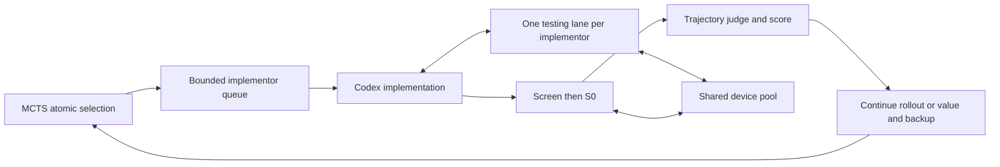

# Asynchronous controller and shared device pool

The controller should minimize idle devices when runnable work exists. Nine
emulators do not imply nine implementors: implementations, Android tasks, judging,
and value calls have different concurrency limits and dependencies.

## Pipeline and admission

1. MCTS atomically selects a plan and reserves one unused implementation slot.
   Multiple trials may use different slots under the same plan. Pending selections
   contribute temporary visits to PUCT selection, but never measured rewards,
   permanent visit counts, or backups.
2. An implementation waits for an implementor admission slot before launching
   Codex. The default limit is nine, configurable independently of nine trial
   workers. All healthy devices may hold reclaimable testing reservations;
   idle reserved devices remain available to canonical evaluation.
3. Each admitted implementor receives one logical testing-device reservation.
   Its targeted tasks run serially on that device. While no check is queued,
   canonical evaluation may borrow it. A queued check reclaims the device at the
   next task boundary, or moves to another idle unreserved device immediately;
   running tasks, resets, and cleanup are never preempted.
   This is guaranteed access with bounded task-boundary wait, not instant access.
4. At handoff, drain admitted checks and release the reservation even on error.
   Freeze the candidate, run Screen, then S0, then trajectory judging, and publish
   its score. One integrated engineering review follows canonical S0 evidence collection. The implementor admission
   slot is free for another Codex invocation while this candidate is evaluated;
   the consumed plan/implementation slot remains part of the permanent tree.
5. Continue the trial or evaluate its frontier value, then transact exactly one
   backup. Existing completion reserves and observed/predicted separation remain.

With nine devices and three implementors requesting checks, three devices test
and six evaluate. With no checks pending, all nine may evaluate. At startup there
may be no child evaluation to run; scheduling cannot manufacture legitimate work.
Expansion ownership still fences publication of distinct frozen plans.

The run-frozen controller setting is `implementor_limit` (default 9). Its
effective admission limit is the smaller of that setting and the healthy device
count. With nine healthy devices and nine eligible trials, nine Codex
implementors may run concurrently. There is no permanently excluded evaluation
device: borrowing and task-boundary reclamation keep the pool shared. This is independent of
`trial_workers` and `device_limit`; all three belong in configuration and reports.

## Work-conserving task dispatch

Choose only tasks compatible with the device's testing reservation. Give that
implementor's queued check priority on its device. Other devices serve canonical
Screen/S0 before background Selection, round-robin across batches and longest
forecast first within a batch. Remove the hard three-tasks-per-batch cap: fairness
determines which runnable batch gets the next device, not whether it is left idle.
Infrastructure retries are admitted when their future completes, rather than
waiting for an unrelated earlier task in manifest order. Preserve output order
and task identities regardless of completion order.

## Failure, shutdown, and recovery

The pool has one worker per physical device; all callbacks include cleanup before
release. Quarantine prevents reuse. If a testing device is quarantined, reassign
its logical reservation to a healthy unreserved device. After pool degradation,
existing reservations may share a physical device serially, or fail when every
device is quarantined. New admission shrinks with the healthy pool.
Never cancel a running callback to increase utilization. Close stops admission
and drains already admitted tasks. In-flight MCTS visits derive from persisted
unreleased selections belonging to active trials, so crash recovery does not invent rewards. Device
reservations are process-local and must be rebuilt only after existing recorded
subprocesses have been reconciled under the coordinator run lock.

### Trial-local outages

An unavailable Android evaluation, unified judge, or twice-failed value call
parks only its trial (`awaiting_evaluation`, `awaiting_judge`, or `awaiting_value`).
The coordinator records these errors with `scope: trial`, frees the worker, and
admits replacement trials within the original trial and invocation caps. Peers
continue their own rollouts and eligible scores can still trigger promotions.
Parked trials keep their evidence, path, occupied implementation slots, and unused
completion reservations. Missing assessments never become rewards or zero values.
Their unreleased selections no longer contribute temporary visits while parked;
permanent statistics still change only through a successful transactional backup.

Selection waits for active workers that can produce progress. When the only
remaining attempts are parked and no eligible child or new slot can be selected,
it returns the computational cutoff `pending_recovery`, not structural exhaustion.
A trial with an observed path still needs a valid frontier value to back up.
An empty path has no edge return to update. Proposal/policy retry exhaustion cuts
off the affected rollout; it does not set the shared stop flag. A later admitted
trial may retry an open expansion or outdated prior using its normal bounded call
reservations. Parked assessments themselves retry only on explicit resume, not in
an automatic admission/retry loop.

Explicit operator stops and unexpected worker failures still close global
admission and drain admitted work. SQLite and operation-ownership failures are
not classified as model outages. Result errors identify these as `scope: global`.
The final run state remains `recovery_pending` if any trial is parked; this is a
summary of unfinished work, not an instruction to truncate unrelated rollouts.

## Validation and rollout

Exercise simultaneous same-plan slot reservation, in-flight PUCT, nine-device
dispatch with competing batches, testing affinity and borrowing, admission limits,
handoff release, quarantine/reassignment, retries arriving out of order, shutdown,
cache reuse, recovery, and exactly-once backup. Run the complete controller suite.
Do not replace a live run's frozen source/configuration. Validate the new protocol
in a separate run under `runs/`, preserving old evidence and historical figures.
Report live device occupancy, queued runnable work, testing reservations, waiting
implementors, and stage times separately from the configured pool size.

## Sequential single-task experiment

Select `controller.type = task_sequence` and provide `sequence.cached_root_run`.
The preparation step freezes all trusted canonical root failures observed in that
source run, sorted by task name. It reports the measured task list too; unmeasured
or infrastructure-invalid tasks are not invented as failures. Confirmation tasks
are excluded. The configured source must exactly match the cached root artifact.

The sequence uses four fresh emulators and an independent tree per task. Each tree
has three plans per expanded harness and a configured one to three implementation
slots per plan, filled through MCTS selection. Sequence construction honors the
configured depth, rollout and attempt limits. The 3x2/depth-4 setup permits four
new implementations per rollout, 30 rollouts, and at most 120 attempts. The
ordinary multi-task defaults remain three attempts per rollout and 90 total.

`evaluation_task` freezes the one task into the tree's objective. Screen is absent;
canonical S0 contains exactly this task with weight one. The unified judge still
scores the harness independently, so F retains the configured mixture of empirical
task full-pass fraction and J. There is no background promotion or separate full-Selection
execution. A missing trusted task result parks the trial rather than scoring zero.

By default, evaluate up to three fresh canonical repetitions sequentially,
stopping node evaluation at its first measured failure. Register later jobs only
after earlier passes; on resume, retain the observed prefix and never continue
after its failure. Infrastructure errors follow their existing bounded recovery
policy and do not count as failed votes. Report actual counts. Stop new admission
only after 3/3 passes with a completed child judge score strictly above the
original task-tree root J, excluding confirmed manipulation. Passing roots use
the same 3/3 requirement with a usable review. Drain admitted work and its exactly-once backups, then select the
highest observed F among qualifying harnesses. Without a qualifying success,
finish the configured rollouts and select the highest observed F across the
eligible stored tree, including root and intermediate nodes. Ties prefer lower
depth, then artifact ID. Set `stop_on_task_success=false` for a full-budget
comparison run. Record the stopping receipt, actual rollout count, and winner
artifact's
actual ancestor plan/implementation path and export the exact immutable harness.
Returns and predicted values guide allocation but are not the final selection
score. An unfinished trial or exhausted request budget prevents advancing to the
next task; the sequence records `recovery_pending` for explicit resume.

The next tree starts from the exported harness, with a separate task objective,
visit statistics, plan archive, and judge assessment. Existing canonical root task
receipts are imported only for the exact unchanged artifact and matching execution
contract, with audited evaluator compatibility and retained evidence hashes.
Changed carried harnesses require their own baseline measurement on the next task.
A selected task's prior measurements do not become another task's score.

The sequence checkpoints `sequence.json`, writes `MONITOR.md` on transitions, and
automatically refreshes `LIVE_MONITOR.md` and `INCIDENTS.md` during execution. Each
task retains its own automatically updated Perfetto trace in `profiling/`.
Sequential optimization does not establish retention on previous tasks; only the
current task is measured. Previously passing tasks and Confirmation are not run.
